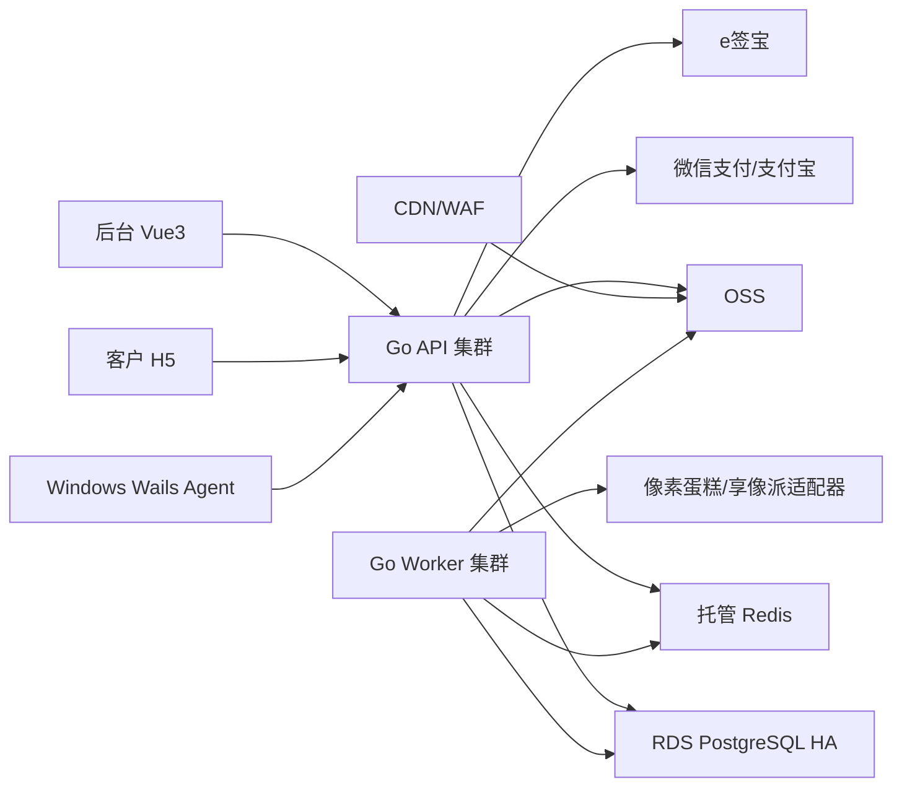

# 摄影师商业工作流平台

## 生产级开发方案

> 本文是 `crisp-tor-chub.md` 的修订版。目标是交付一个可用于商业项目的多租户 SaaS，而不是个人脚本或带人工兜底的演示系统。

## 1. 产品目标与硬约束

### 1.1 目标

系统覆盖一个商业摄影项目从线索到归档的完整链路：

```text
线索 → 需求确认 → 报价 → 合同/电子签 → 支付 → 排期
→ 拍摄准备 → 素材采集 → 初筛/选片 → 外部修图
→ 审片/返修 → 尾款 → 交付 → 归档/复购
```

### 1.2 已确定的产品决策

| 项目 | 决策 |
|---|---|
| 产品形态 | 完整商业 SaaS，多租户从第一天启用 |
| 首个平台 | Windows Wails Agent；macOS 后置 |
| 生产支付 | 微信支付 API v3 + 支付宝 RSA2 直连 |
| 生产签署 | 第三方电子签，首个适配器为 e签宝 |
| 生产部署 | 阿里云 RDS PostgreSQL、Redis、OSS、CDN、WAF |
| 图片链路 | 原片和派生图直传 OSS，API 不中转图片字节 |
| 外部后期软件 | 正式 API、FTP 或目录适配器；不复制其业务能力 |
| 失败处理 | 重试、死信、告警、人工处理工单；禁止绕过业务规则 |
| 收款状态 | 只能来自支付回调、对账结果或授权的退款流程，禁止手工改 paid |
| 合同状态 | 只能来自电子签平台回调和签署证据链 |

### 1.3 明确禁止

- 不把人工核销作为支付替代路径。
- 不把上传扫描件后人工确认作为电子签替代路径。
- 不把线下文件拷贝作为 Agent 上传失败后的自动降级路径。
- 不允许后台直接跳过状态机修改订单状态。
- 不允许未支付尾款直接生成可下载交付包。
- 不允许未完成签署的合同进入正式 booked 状态。

## 2. 商业摄影业务流程

| 阶段 | 业务动作 | 系统结果与闸门 |
|---|---|---|
| 线索 | 来源、客户、用途、预算、日期、联系人 | `leads`、跟进任务、响应 SLA |
| 需求 | 风格、数量、场地、人员、交付规格、版权用途 | `briefs`、需求变更记录 |
| 报价 | 服务费、后期费、制作费、交通、加急、授权费 | 版本化 `quotes`，发送后冻结 |
| 合同 | 交付数量、期限、版权、返修、取消、付款节点 | 合同快照、电子签任务 |
| 支付 | 定金、尾款、额外返修、退款 | Provider 回调、对账、发票 |
| 排期 | 摄影师、影棚、化妆师、助理、器材、缓冲 | GiST 排他约束，禁止撞档 |
| 拍前 | shot list、call sheet、勘景、器材、授权 | `prep` 清单和提醒 |
| 拍摄 | 多卡采集、双备份、现场记录 | `ingest_batches` 和 manifest |
| 初筛 | EXIF、重复、模糊、闭眼、连拍最佳 | `cull_sessions`、AI 仅作建议 |
| 选片 | 客户收藏、选择、拒绝、提交 | 不可变相册版本和截止时间 |
| 后期 | 调色、精修、合成、外部软件任务 | `retouch_tasks`、资产版本 |
| 审片 | 批注、返修轮次、变更单 | 免费轮次和计费闸门 |
| 交付 | 尺寸、格式、色彩空间、命名、水印 | `deliveries`、下载授权 |
| 归档 | 原片、合同、授权、账单、交付记录 | 保留策略、审计、复购提醒 |

## 3. 状态模型

不再使用一个状态字段承载全部业务。每个聚合拥有独立状态机，项目页展示聚合状态投影。

### 3.1 项目生命周期

```text
draft → quoted → contract_pending → contracted → booked
→ shooting → post_production → completed → archived
```

任何未终态均可进入 `on_hold` 或 `cancelled`，但必须记录原因和操作者。

### 3.2 支付状态

```text
unpaid → deposit_pending → deposit_paid
→ balance_pending → paid
```

退款独立为 `refund_pending → refunded|refund_failed`，不得覆盖原支付记录。

### 3.3 素材状态

```text
registered → uploaded → verified → derivative_ready
→ culled → selected → retouching → proofing
→ approved → delivered → archived
```

异常状态：`missing`、`corrupt`、`quarantined`、`integration_failed`。

### 3.4 合同状态

```text
draft → rendered → sent → signing → signed → void
```

`signed` 只能由电子签平台验签后的回调事务产生。

### 3.5 审片轮次

```text
open → in_review → changes_requested → retouching
→ resubmitted → approved
```

超出合同包含轮次时，必须完成变更单签署和支付后才可创建修图任务。

## 4. 生产架构



### 4.1 部署单元

```text
api       无状态 HTTP API，至少 2 个实例
worker    异步任务消费者，按队列独立扩容
scheduler 定时提醒、对账、过期锁位和归档任务
migrate   只执行数据库迁移，不参与在线流量
agent     摄影师本地 Windows 客户端
```

首版不拆微服务，但 API、Worker、Scheduler 必须可独立发布和扩容。

### 4.2 队列

队列按资源和失败策略拆分：

```text
metadata      元数据批量写入
derivative    缩略图、水印、视频代理
package       ZIP/交付包生成
integration   外部后期软件任务
notification  短信、邮件、企业微信
payment       对账和退款状态同步
archive       归档、校验、生命周期任务
```

Asynq 的 Unique 只用于减少重复入队，业务幂等必须由数据库唯一键和任务执行记录保证。每个任务需要最大重试次数、退避策略、死信状态和告警。

## 5. 多租户、权限与安全

### 5.1 多租户

- 所有业务表都有 `tenant_id`。
- 所有业务查询显式带 `tenant_id`。
- 使用 PostgreSQL RLS 作为第二层隔离。
- 跨租户资源访问统一返回 404，避免泄露资源存在性。
- 对象存储 key 以 `tenant_id/project_id/content_hash` 分层。
- 首版不做 16 分区；单表达到数千万行且出现维护瓶颈后再评估。

### 5.2 角色

```text
owner      租户全部权限
staff      商务、项目、图库、交付
retoucher  被分配的后期任务和对应素材
assistant  拍摄准备、采集和只读视图
client     仅访问授权相册、合同、支付和审片资源
```

客户 token 必须绑定 `tenant_id`、`project_id`、`gallery_id`、权限范围、过期时间和撤销状态。

### 5.3 安全

- access token 15 分钟，refresh token 轮换并可撤销。
- 密码使用 Argon2id。
- 支付密钥、电子签密钥、OSS 密钥放 KMS/密钥管理服务。
- 原片和合同对象使用服务端加密。
- 公开 token 只保存哈希。
- 所有支付、合同、退款、授权、下载、状态迁移写审计。
- 日志不得输出 token、密码、密钥、完整手机号和身份证号。

## 6. 核心数据模型

### 6.1 业务表

```text
tenants users memberships refresh_tokens
clients leads briefs projects project_state_logs
quotes quote_items contracts contract_terms usage_licenses consents
resources availability_rules bookings booking_resources resource_blocks
shoots call_sheets shot_lists shot_items gear_items shoot_gear
ingest_batches ingest_files assets asset_derivatives asset_revisions
cull_sessions cull_decisions galleries gallery_tokens selections
proof_rounds comments retouch_tasks retouch_task_items change_orders
deliveries delivery_items download_tokens invoices payment_orders payments refunds
integration_accounts integration_jobs outbox_events audit_logs
idempotency_keys notifications notification_deliveries archives retention_policies
```

### 6.2 关键约束

- `assets`: `UNIQUE (tenant_id, project_id, content_hash)`。
- `asset_revisions`: `UNIQUE (asset_id, version)`，版本由事务内锁保证递增。
- `payment_orders`: `UNIQUE (tenant_id, out_trade_no)` 和渠道流水唯一约束。
- `gallery_tokens`: 只保存哈希，支持过期、撤销、最大访问次数。
- `resource_blocks`: 使用 `tenant_id + resource_id + tstzrange` 排他约束。
- 所有金额使用 `bigint` 分和 `currency`，禁止浮点。
- 所有时间存 UTC `timestamptz`，展示使用租户时区。
- 所有交付文件记录对象 key、版本、checksum、大小和生成任务。

## 7. 合同、电子签与支付

### 7.1 报价

报价保存完整快照，包含明细、条款、模板版本和有效期。报价发送后不可修改，只能生成新版本。

### 7.2 e签宝

接口边界：

```text
CreateSignTask
GetSignURL
CancelSignTask
HandleCallback
DownloadSignedDocument
VerifyEvidence
```

回调处理流程：

```text
验签 → 校验租户/合同/任务 → 幂等更新签署状态
→ 下载并校验签署文件 → 写审计和 Outbox
→ 合同 signed → 项目可进入 booked
```

### 7.3 微信支付和支付宝

统一接口：

```go
type PaymentProvider interface {
    CreateOrder(ctx context.Context, req CreateOrderRequest) (PaymentParams, error)
    VerifyCallback(ctx context.Context, req CallbackRequest) (PaymentResult, error)
    QueryOrder(ctx context.Context, outTradeNo string) (PaymentResult, error)
    Refund(ctx context.Context, req RefundRequest) error
    Reconcile(ctx context.Context, date time.Time) ([]ProviderRecord, error)
}
```

两种 Provider 都必须完成：下单、回调验签、金额校验、订单幂等、对账、退款和异常告警。

任何支付回调重复到达时，只能产生一条 `payments` 记录。金额、商户号、应用 ID、订单号不一致时拒绝入账并产生安全告警。

## 8. Windows Agent

### 8.1 采集管线

```text
检测卡片 → 建立批次 → 扫描文件 → 双目的地复制
→ fsync → SHA-256 → 原子 rename → 登记元数据
→ 生成预览 → OSS 分片上传 → 服务端校验
```

### 8.2 文件完整性

- 不使用 mtime 作为完整校验依据。
- 临时文件不得使用最终文件名。
- 两个目的地均校验成功后才允许本地 `verified`。
- 上传完成后服务端验证对象大小和 SHA-256。
- 卡片永不自动删除。
- Agent 崩溃后从 SQLite 恢复任务和分片列表。

### 8.3 RAW 与视频

- RAW 首选提取内嵌 JPEG 预览。
- JPEG、PNG、HEIC 使用 libvips 生成派生图。
- 视频使用 ffmpeg 生成代理视频和封面。
- 任何无法生成预览的资产进入 `derivative_failed`，不得无提示发布图库。

## 9. 图库、选片与 CDN

- 相册发布生成不可变 manifest 版本。
- manifest 放 OSS/CDN，不经 API 中转图片。
- 图片使用短期签名 URL。
- 相册 token 可撤销，撤销后 API 不再签发新 URL。
- 客户端使用虚拟滚动、懒加载、blurhash 和相邻图片预取。
- 选片使用游标分页和批量幂等写入。
- 服务端采用最后一次带版本号的有效写入，冲突返回 409。
- 相册发布前检查所有必需派生图是否完成。

目标：2,000 张相册、300 并发浏览、CDN 命中率大于 95%，API 只承担清单和写入操作。

## 10. 排期与拍摄准备

### 10.1 资源

资源类型：摄影师、影棚、化妆师、助理、器材。

### 10.2 防撞档

所有确认预约、临时锁位、休息、外出和手工屏蔽都写入 `resource_blocks`。数据库排他约束是唯一仲裁者，应用层冲突检测只用于改善提示。

锁位和支付存在竞态时：

```text
锁位有效 → 支付成功 → 确认预约
锁位过期且已被占用 → 支付失败/退款任务 → 告警
```

不得出现支付成功但系统静默覆盖其他预约的情况。

## 11. 后期、外部集成与审片

### 11.1 适配器

```go
type RetouchIntegration interface {
    Submit(ctx context.Context, req SubmitRetouchRequest) (IntegrationJob, error)
    Query(ctx context.Context, externalID string) (IntegrationStatus, error)
    HandleCallback(ctx context.Context, req CallbackRequest) error
    ImportResult(ctx context.Context, req ImportResultRequest) error
}
```

首版实现：

```text
FolderWatchAdapter
FTPAdapter
PixCakeAdapter
XiangxiangAdapter
```

每次文件进入和离开外部软件都记录 checksum、文件版本、任务 ID 和时间。重复回传必须幂等，checksum 不一致必须进入失败状态。

### 11.2 审片

批注坐标相对于图片内容区归一化为 0–1，支持点、框、椭圆和自由笔。批注、回复、解决和返修任务全部可审计。

第 1、2 轮是否免费由合同决定；超过合同轮次时：

```text
生成变更单 → e签宝签署 → 支付成功 → 创建修图任务
```

任何一步未完成都不能创建额外返修任务。

## 12. API 设计

### 后台 API

```text
/api/v1/auth
/api/v1/tenants
/api/v1/clients
/api/v1/leads
/api/v1/projects
/api/v1/quotes
/api/v1/contracts
/api/v1/bookings
/api/v1/prep
/api/v1/galleries
/api/v1/proof-rounds
/api/v1/deliveries
/api/v1/invoices
/api/v1/payments
/api/v1/integrations
/api/v1/audit-logs
```

### Agent API

```text
/agent/v1/devices
/agent/v1/heartbeats
/agent/v1/ingest-batches
/agent/v1/ingest-batches/{id}/assets:batch
/agent/v1/ingest-batches/{id}/finalize
/agent/v1/uploads:presign
/agent/v1/uploads/{id}/complete
/agent/v1/jobs
/agent/v1/jobs/{id}/ack
```

### 客户 API

```text
/g/v1/session
/g/v1/albums/{token}/manifest
/g/v1/selections
/g/v1/comments
/g/v1/proof-rounds
/g/v1/download-requests
```

### Webhook

```text
/webhooks/payment/wechat
/webhooks/payment/alipay
/webhooks/esign/esignbao
/webhooks/integration/{provider}
```

所有创建、支付、预约、选择和状态变更接口支持 `Idempotency-Key`。所有异步操作返回 `202 + job_id`。

## 13. 异步一致性

业务写入和 Outbox 事件必须在同一数据库事务中提交。Dispatcher 使用 `FOR UPDATE SKIP LOCKED` 获取任务，消费端必须幂等。

Outbox 状态：

```text
pending → processing → sent
pending → retrying → sent
pending → dead_letter
```

每个死信必须包含原始 payload、错误、重试次数、最后尝试时间和关联业务对象。

## 14. 可观测性和可靠性

必须监控：

- API p50/p95/p99、错误率和限流率；
- 数据库连接池等待、慢查询和锁等待；
- Redis 内存、命中率和队列深度；
- Worker 各队列等待时间、成功率、重试率和死信数；
- Agent 上传速度、失败率、磁盘余量和版本；
- CDN 命中率、403 率和源站回源量；
- 支付回调失败、金额不一致和对账差异；
- 电子签任务失败和回调延迟；
- 外部修图任务超时和 checksum 不一致。

目标：API 月可用性 99.9%，RPO 不超过 15 分钟，RTO 不超过 1 小时。数据库和对象存储必须完成恢复演练后才允许正式上线。

## 15. 开发里程碑

### M0：基础硬化，2 周

- 强制项目版本号；
- 修正批次 finalize 语义；
- 增加 Outbox、任务表和 Worker 基础；
- 补齐外键、RLS、审计和幂等；
- 增加统一超时、指标和 trace。

### M1：商务与电子签，4 周

- 线索、客户、需求简报；
- 报价版本和合同快照；
- e签宝创建、签署、回调和证据归档；
- 版权、肖像、场地和作品集授权。

### M2：支付与账务，4 周

- 微信支付 API v3；
- 支付宝 RSA2；
- 支付回调、对账、退款；
- 发票和变更单；
- 支付安全告警。

### M3：排期与拍前准备，3 周

- 资源、规则、锁位、预约；
- GiST 防撞档；
- shot list、call sheet、器材和授权；
- 自动提醒。

### M4：Windows Agent，5 周

- 读卡、双写、校验；
- SQLite 任务恢复；
- EXIF 和预览；
- OSS 分片上传；
- 断点恢复、安装包和自动更新。

### M5：图库与选片，4 周

- manifest 快照；
- CDN 签名 URL；
- 虚拟滚动图库；
- 选片、收藏、拒绝、提交；
- 截止时间和通知。

### M6：后期集成与审片，4 周

- 文件夹、FTP、像素蛋糕、享像派适配器；
- 修图任务和资产版本；
- 批注、返修、变更单；
- 外部任务失败和告警。

### M7：交付、归档和上线，4 周

- 多规格交付；
- 下载授权；
- 尾款闸门；
- 归档和保留策略；
- 压测、灾备、安全和支付回放。

完整商业版本按 29–32 周估算，不再使用原文 22 周作为承诺。

## 16. 验收标准

### 业务

- 未签合同不能 booked；
- 定金未支付不能确认档期；
- 尾款未支付不能交付；
- 第三轮返修未签变更单且未支付不能创建任务；
- 支付回调重复 100 次只入账一次；
- 电子签回调重复 100 次只产生一个签署结果；
- 取消、退款、改期和归档都有审计记录。

### 数据与安全

- 租户 A 无法读取租户 B 任意对象；
- 所有公开 token 可撤销且只保存哈希；
- 对象大小和 SHA-256 均通过后才能 verified；
- 任何状态跳过都返回明确错误码；
- 数据库恢复和对象存储恢复演练成功。

### 性能

- 元数据 500 条批量写入 p95 < 300ms；
- 普通 API p95 < 300ms；
- 选择写入 p95 < 300ms；
- 2,000 张相册、300 并发浏览无 API 图片转发；
- 200 并发抢同一档期只有一个成功；
- Worker 失败任务进入重试或死信，不丢失。

### Agent

- 拔卡后可恢复；
- 进程崩溃后可恢复；
- 磁盘满能暂停并告警；
- 两个本地副本校验一致才显示完成；
- 分片上传断点恢复；
- 同一张卡重复插入不产生重复资产。

## 17. 上线前置条件

- 微信支付商户号、API v3 证书和公网 HTTPS；
- 支付宝应用、RSA2 密钥和回调域名；
- e签宝企业账号和生产密钥；
- 阿里云 RDS、Redis、OSS、CDN、WAF；
- OSS 服务端加密和生命周期策略；
- 短信、邮件和企业微信通知通道；
- Windows 代码签名证书；
- 生产监控、告警和备份恢复演练；
- 合同模板、版权条款、隐私政策和数据保留政策。

## 18. 技术选型

```text
Go 1.26+
chi
pgx/v5 + sqlc
PostgreSQL 16+
Redis 7+
Asynq
goose
Wails v2
Vue 3 + TypeScript
libvips + ffmpeg
exiftool
OpenAPI + oapi-codegen
Prometheus + Grafana + Loki + OpenTelemetry
k6 + testcontainers-go
```

核心原则：先保证业务不变量、数据一致性和可审计，再优化吞吐；图片字节永远不经过 Go API；任何失败都必须可观测、可重试、可追责。
